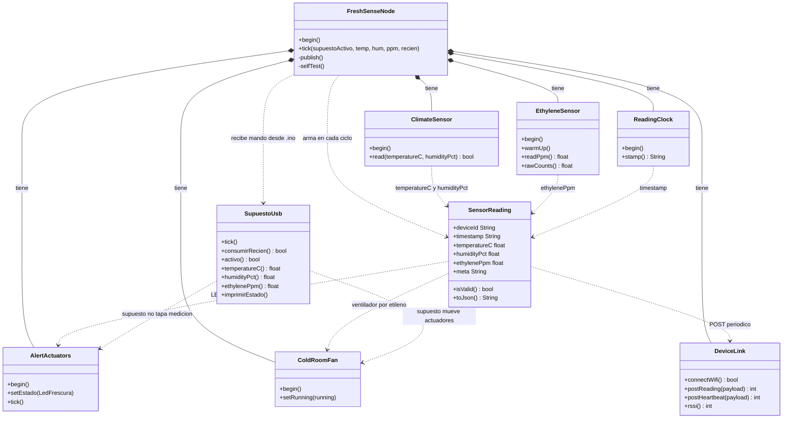

# Diagrama de clases — Embebed System (FreshSense)

Dispositivo IoT de cámara de frío para **frutas** (estándar FS-FRUIT-1).

- Código normal: `prototipo1/FreshSenseNode.h`
- Supuesto USB: `prototipo1/FreshSenseSupuesto.h` (archivo aparte)
- Entrada: `prototipo1/prototipo1.ino`
- Página local: `servidor/servidor.py`

## Dibujo

## Qué hace cada clase

| Clase | Archivo | Trabajo |
|---|---|---|
| `FreshSenseNode` | `FreshSenseNode.h` | Orquesta lecturas (clima 3 min, gas 1 min), FS-FRUIT-1 y actuadores |
| `SupuestoUsb` | `FreshSenseSupuesto.h` | Lee `SUPUESTO` / `REAL` por USB; no reemplaza SensorReading |
| `ClimateSensor` | `FreshSenseNode.h` | AM2302 GPIO 4 → temp + humedad |
| `EthyleneSensor` | `FreshSenseNode.h` | MQ135 GPIO 34 → ppm |
| `AlertActuators` | `FreshSenseNode.h` | LED 27 + buzzer 25 según temp/hum (SEMI continuo, CRÍTICO parpadeo) |
| `ColdRoomFan` | `FreshSenseNode.h` | Relé 26 → motor si etileno SEMI/CRÍTICO (> 1 ppm) |
| `SensorReading` | `FreshSenseNode.h` | Agregado del informe + `isValid()` + JSON |
| `DeviceLink` | `FreshSenseNode.h` | WiFi opcional + POST lectura/heartbeat |
| `ReadingClock` | `FreshSenseNode.h` | Timestamp Lima / reloj local |

## Reglas FS-FRUIT-1 (resumen)

- **LED** ← temperatura y humedad (independiente; basta un sensor anómalo)
- **Ventilador** ← etileno (> 1 ppm)
- **FRESH / AT_RISK / SPOILED** según el peor nivel de los tres sensores
